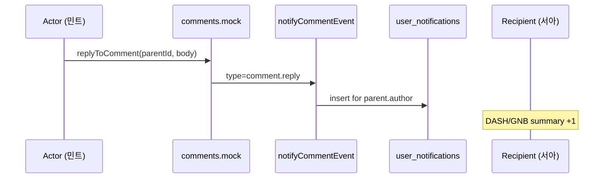
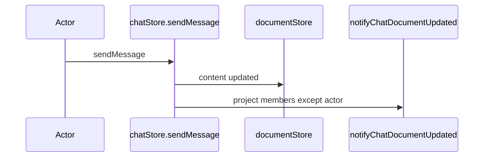

# PlanOS — 대시보드 알림 (채팅·댓글) 설계서

> 작성일: 2026.06.10  
> 상태: **N1 UI + N4 Real API 완료** (N2~N3·Realtime 미구현)  
> 연관: [`MEMBER_COMMENTS_DESIGN.md`](./MEMBER_COMMENTS_DESIGN.md), [`MEMBER_PERMISSIONS_DESIGN.md`](./MEMBER_PERMISSIONS_DESIGN.md), [`HISTORY_AND_EXPORT_DESIGN.md`](./HISTORY_AND_EXPORT_DESIGN.md), [`TECH_SPEC.md`](./TECH_SPEC.md)

---

## 1. 배경 & 문제

### 1.1 현재 (갭)

| 화면 | 현재 | 문제 |
|------|------|------|
| **DASH-001** 대시보드 | 프로젝트 카드 그리드만 | 멤버 활동·미확인 피드백을 한눈에 볼 수 없음 |
| **GNB** | Dashboard / Projects / 아바타 | 전역 알림 벨·뱃지 없음 |
| **DOC-001** | 탭별 미완료 댓글 뱃지 (C1) | 문서 안에 들어가야만 인지 가능 |
| **L4 활동 로그** | `HistoryPanel` 타임라인 | **감사·추적**용 — 「내가 확인해야 할 일」과 목적이 다름 |

팀 멤버가 댓글을 남기거나 AI 채팅으로 문서를 수정해도, **대시보드에 돌아오면 무엇이 바뀌었는지 알 수 없습니다.**

### 1.2 목표

| 목표 | 설명 |
|------|------|
| **한눈에 파악** | 대시보드에서 프로젝트별·유형별 미확인 알림 확인 |
| **빠른 이동** | 알림 클릭 → 해당 프로젝트·산출물·댓글 스레드로 딥링크 |
| **채팅·댓글 분리 표시** | AI 채팅(문서 변경) vs 멤버 코멘트(협업)를 아이콘·색으로 구분 |
| **노이즈 최소화** | 본인 행동·해결된 스레드·휴지통 프로젝트는 알림 제외 |
| **활동 로그와 분리** | L4는 히스토리, **L6 알림**은 사용자 인박스 |

### 1.3 비목표 (V1)

- 이메일·푸시·Slack 웹훅 (V2)
- 알림 설정 세분화 UI (V2 — MVP는 전체 on)
- PROJ-001 전용 알림 패널 (대시보드·GNB로 통합, PROJ는 카드 뱃지만)
- 실시간 WebSocket (N4 Supabase Realtime 전)

---

## 2. 용어 & 기존 계층과의 관계

```
┌────────────────────────────────────────────────────────────┐
│ L6  사용자 알림 (user_notifications)  — 인박스·미읽음     │  ← 신규
├────────────────────────────────────────────────────────────┤
│ L5  멤버 코멘트 (project_comments)     — 협업·리뷰         │
├────────────────────────────────────────────────────────────┤
│ L4  활동 로그 (project_activities)     — 감사·히스토리     │
├────────────────────────────────────────────────────────────┤
│ L3  AI 채팅 (chat_messages)            — 1:1 AI 수정       │
└────────────────────────────────────────────────────────────┘
```

| 구분 | L4 활동 로그 | L6 알림 |
|------|-------------|---------|
| 관점 | 프로젝트 단위 이벤트 기록 | **수신자(user)별** 인박스 |
| UI | DOC `HistoryPanel` | DASH 피드 + GNB 🔔 |
| 읽음 상태 | 없음 | `read_at` |
| 대상 | 프로젝트 멤버 공통 조회 | **개인별** 생성·필터 |

**채팅 알림의 의미:** PlanOS AI 채팅은 팀 채팅이 아닙니다. 알림 대상은 **다른 멤버의 AI 채팅으로 문서 본문이 변경된 경우**입니다 (협업 인지용).

---

## 3. 알림 유형

### 3.1 댓글 (Comment)

| 타입 코드 | 트리거 | 수신자 | 우선순위 |
|-----------|--------|--------|----------|
| `comment.mention` | 본문에 `@이름` 또는 `@email` 포함 | 멘션된 멤버 | 높음 |
| `comment.reply` | 내 댓글·루트에 직접 답글 | 댓글 작성자 | 높음 |
| `comment.thread_activity` | 참여 스레드에 새 답글 (내가 participant) | `participant_status=pending` 멤버 | 중간 |
| `comment.resolve` | 스레드 완료 처리 | 스레드 참여자 (actor 제외) | 낮음 |
| `comment.reopen` | 스레드 재오픈 | 스레드 참여자 (actor 제외) | 낮음 |

**알림 미생성 조건**

- 알림 행위자(actor) = 수신자 본인
- 스레드 `resolved` 후 `thread_activity` (선택: resolve만 알림, 추가 답글 없음)
- `comment.view` 권한 없는 멤버
- 프로젝트 `deleted_at` 설정됨 (휴지통)
- 멤버 `status !== 'active'`

### 3.2 AI 채팅 (Chat)

| 타입 코드 | 트리거 | 수신자 | 우선순위 |
|-----------|--------|--------|----------|
| `chat.document_updated` | 팀원 AI 채팅 후 **문서 content 변경** | 프로젝트 active 멤버 (actor 제외) | 중간 |

**알림 미생성 조건**

- 채팅만 하고 문서 미변경 (`sendMessage` 반환 null)
- actor 본인
- `project.view` 없음
- viewer는 수신 **기본 on** (문서 변경 인지 필요) — V2에서 설정으로 off 가능

### 3.3 집계 뱃지 (카드·GNB)

| 위치 | 표시 |
|------|------|
| GNB 🔔 | 전체 미읽음 수 (99+ cap) |
| 프로젝트 카드 | 미읽음 합계 또는 `🗨{n}` 댓글 + `💬{n}` 채팅 분리 칩 |
| DOC 사이드바 탭 | 기존 C1 `open` 스레드 수 유지 (알림과 별개) |

---

## 4. 화면 설계

### 4.1 DASH-001 레이아웃 (2열)

데스크톱(≥1024px)에서 **우측 알림 패널** 고정. 좁은 화면에서는 GNB 드롭다운만.

```
┌─────────────────────────────────────────────────────────────────────────┐
│ PlanOS   Dashboard  Projects                        🔔3    [아바타]      │
├─────────────────────────────────────────────────────────────────────────┤
│ 안녕하세요, 서아님                              [ + 새 프로젝트 ]         │
├───────────────────────────────────────┬─────────────────────────────────┤
│                                       │  알림                    모두 읽음 │
│  ┌─────────┐  ┌─────────┐            │  ─────────────────────────────  │
│  │ 모바일앱 │  │ SaaS B2B│            │  🗨 민트 · PRD                  │
│  │ PRD·IA  │  │ 🗨2 💬1 │            │     「KPI 구체화 필요」에 답글    │
│  └─────────┘  └─────────┘            │     5분 전                      │
│                                       │  ─────────────────────────────  │
│  ┌ ─ ─ ─ ─ ┐                          │  💬 김개발 · IA                 │
│  │ 새 프로젝트│                          │     AI 채팅으로 문서 수정       │
│  └ ─ ─ ─ ─ ┘                          │     1시간 전                    │
│                                       │  ─────────────────────────────  │
│                                       │  🗨 @나 · 화면목록               │
│                                       │     멘션: 검토 부탁드려요         │
│                                       │     어제                          │
└───────────────────────────────────────┴─────────────────────────────────┘
```

### 4.2 GNB 알림 드롭다운

- 🔔 클릭 → 최근 20건 팝오버 (모바일·태블릿 주 UI)
- 하단 「대시보드에서 모두 보기」→ DASH 스크롤
- 빈 상태: 「새 알림이 없습니다」

### 4.3 프로젝트 카드 뱃지

`ProjectCard` 우상단 오버레이:

```
┌──────────────────┐
│ 모바일 앱 PRD  🗨2│  ← 미읽음 댓글
│                  💬1│  ← 미읽음 채팅(문서변경)
│ PRD · IA         │
└──────────────────┘
```

- 카드 클릭: 기존과 동일 `last_doc_type` 진입
- 뱃지만 클릭(optional N2): 알림 필터된 피드 또는 첫 미읽음 딥링크

### 4.4 알림 행 UI

| 요소 | 규격 |
|------|------|
| 아이콘 | 🗨 댓글 / 💬 AI채팅 |
| 제목 | `{actor_name} · {DOCUMENT_TYPE_LABELS[docType]}` |
| 본문 | 이벤트 요약 1줄 (댓글 excerpt 60자 truncate) |
| 시간 | 상대 시간 (`5분 전`) |
| 미읽음 | `bg-brand-50` 배경 + 좌측 3px accent |
| 읽음 | `bg-white`, 클릭 시 `read_at` 설정 |

---

## 5. 딥링크 & 읽음 처리

### 5.1 URL 패턴

| 유형 | URL |
|------|-----|
| 댓글 (스레드) | `/projects/{projectId}/{docPath}?panel=comments&thread={threadRootId}` |
| 댓글 (멘션) | 동일 |
| AI 채팅 | `/projects/{projectId}/{docPath}?panel=chat` |

- `panel` 쿼리는 DOC-001 우측 패널 토글과 연동 (기존 레이아웃)
- `thread`는 C2 딥링크와 통합

### 5.2 읽음 정책

| 동작 | 처리 |
|------|------|
| 알림 행 클릭 | 해당 알림 `read_at = now()` + navigate |
| 「모두 읽음」 | 현재 사용자 미읽음 전체 일괄 처리 |
| DOC 진입 + 스레드 확인 | 해당 `thread_root_id` 관련 알림 일괄 읽음 (N2) |
| 휴지통 복원 | 알림은 삭제하지 않음, 링크 시 복원 CTA |

---

## 6. 데이터 모델

### 6.1 `user_notifications`

```sql
CREATE TABLE user_notifications (
  id            UUID PRIMARY KEY DEFAULT gen_random_uuid(),
  user_id       UUID NOT NULL REFERENCES users(id) ON DELETE CASCADE,
  project_id    UUID NOT NULL REFERENCES projects(id) ON DELETE CASCADE,
  document_id   UUID REFERENCES documents(id) ON DELETE SET NULL,
  type          TEXT NOT NULL,  -- comment.* | chat.*
  actor_id      UUID REFERENCES users(id) ON DELETE SET NULL,
  actor_name    TEXT NOT NULL,
  title         TEXT NOT NULL,  -- "민트 · PRD"
  body          TEXT NOT NULL,  -- 요약 문구
  link_path     TEXT NOT NULL,  -- /projects/.../prd?panel=comments&thread=...
  thread_root_id UUID,          -- 댓글 알림용
  comment_id    UUID,           -- 트리거 코멘트
  chat_message_id UUID,         -- 채팅 알림용
  read_at       TIMESTAMPTZ,
  created_at    TIMESTAMPTZ NOT NULL DEFAULT now()
);

CREATE INDEX idx_notifications_user_unread
  ON user_notifications (user_id, created_at DESC)
  WHERE read_at IS NULL;

CREATE INDEX idx_notifications_user_project
  ON user_notifications (user_id, project_id, created_at DESC);
```

### 6.2 TypeScript

```typescript
export type NotificationType =
  | 'comment.mention'
  | 'comment.reply'
  | 'comment.thread_activity'
  | 'comment.resolve'
  | 'comment.reopen'
  | 'chat.document_updated'

export interface UserNotification {
  id: string
  user_id: string
  project_id: string
  project_title: string
  document_id: string | null
  doc_type: DocumentType | null
  type: NotificationType
  actor_id: string | null
  actor_name: string
  title: string
  body: string
  link_path: string
  thread_root_id: string | null
  comment_id: string | null
  chat_message_id: string | null
  read_at: string | null
  created_at: string
}

export interface NotificationSummary {
  total_unread: number
  by_project: Record<string, { unread: number; comment: number; chat: number }>
}
```

### 6.3 알림 생성 시점 (Real API)

| 이벤트 | 생성 함수 |
|--------|----------|
| `replyToComment` | `notifyCommentCreated` → `comment.reply` |
| `createRootComment` + `@멘션` | `notifyCommentCreated` → `comment.mention` |
| `setThreadResolved` / reopen | `notifyThreadResolved` |
| `sendChatMessage` + content 변경 | `notifyChatDocumentUpdated` |

---

## 7. API & Store

### 7.1 API (`lib/api/notifications.ts`)

```typescript
fetchNotifications(opts?: { limit?: number; projectId?: string }): Promise<UserNotification[]>
fetchNotificationSummary(): Promise<NotificationSummary>
markNotificationRead(id: string): Promise<void>
markAllNotificationsRead(projectId?: string): Promise<void>
```

Real: `src/lib/api/notifications.ts` + `src/lib/notifications/notify.ts` → `user_notifications` 테이블

### 7.2 `notificationStore` (Zustand)

```typescript
interface NotificationState {
  items: UserNotification[]
  summary: NotificationSummary | null
  isLoading: boolean

  fetchNotifications: () => Promise<void>
  fetchSummary: () => Promise<void>
  markRead: (id: string) => Promise<void>
  markAllRead: (projectId?: string) => Promise<void>
  reset: () => void
}
```

### 7.3 컴포넌트

| 컴포넌트 | 파일 | 역할 |
|---------|------|------|
| `NotificationBell` | `layout/NotificationBell.tsx` | GNB 🔔 + 드롭다운 |
| `NotificationFeed` | `dashboard/NotificationFeed.tsx` | DASH 우측 패널 |
| `NotificationItem` | `dashboard/NotificationItem.tsx` | 단일 행 |
| `ProjectNotificationBadges` | `project/ProjectNotificationBadges.tsx` | 카드 뱃지 |

---

## 8. 권한 & 정책

| 역할 | 알림 수신 | 비고 |
|------|----------|------|
| owner | ✅ 전체 | |
| editor | ✅ 전체 | |
| viewer | ✅ 댓글 + 문서변경 채팅 | `comment.create` 가능 |
| pending | ❌ | 수락 후부터 |
| 비멤버 | ❌ | |

휴지통 프로젝트: 신규 알림 생성 중단, 기존 알림은 DASH에 「휴지통 이동됨」으로 표시하거나 숨김 (N1: **숨김**).

---

## 9. 플로우

### 9.1 댓글 답글 → 알림



### 9.2 AI 채팅 문서 변경 → 알림



---

## 10. 구현 Phase

### Phase N1 — Mock 핵심 ⭐ ✅

- [x] `UserNotification` 타입
- [x] `notificationStore` + `notifications.ts` Real API
- [x] `NotificationFeed` — DASH 우측 패널 (lg+)
- [x] `NotificationBell` — GNB 드롭다운 + 미읽음 뱃지
- [x] `ProjectNotificationBadges` — `ProjectCard` 연동
- [x] `markRead` / `markAllRead`
- [x] 댓글·채팅 API에서 알림 생성 (`notify.ts`)
- [x] DOC `?panel=` / `?thread=` 쿼리 파싱 (DocumentPage)

### Phase N2 — 멘션·집계 보강

- [x] `@멘션` 파싱 + `comment.mention` (`notify.ts` — `comment_mentions` 테이블 없음)
- [ ] 프로젝트 진입 시 관련 알림 일괄 읽음
- [ ] PROJ-001 카드 뱃지 동일 적용
- [ ] 알림 필터 탭 (전체 / 댓글 / 채팅)

### Phase N3 — UX polish

- [ ] 무한 스크롤 / 페이지네이션
- [ ] 빈 상태 일러스트
- [ ] 상대 시간 — `formatRelativeTime` in `helpers.ts` ✅ (date-fns 미사용)

### Phase N4 — Supabase & Realtime

- [x] `user_notifications` 마이그레이션 + RLS (`007_user_notifications.sql`)
- [x] 클라이언트 `notify.ts` → DB insert (댓글·채팅 이벤트)
- [x] `notifications.ts` Real API (fetch·markRead)
- [ ] Realtime 구독 → GNB 뱃지 즉시 갱신

---

## 11. 에러·엣지 케이스

| 상황 | 처리 |
|------|------|
| 동일 스레드 1분 내 연속 답글 | N1: 건별 알림 / N3: 스레드 단위 digest (선택) |
| 멘션 대상 비멤버 | 알림 생성 skip |
| 문서 삭제·재생성으로 document_id 변경 | `link_path`만 유효하면 OK, 없으면 프로젝트 홈 |
| actor 탈퇴 | `actor_name` 스냅샷 유지 |
| 100+ 미읽음 | GNB `99+`, DASH 「모두 읽음」강조 |
| 알림 없을 때 DASH | 우측 패널 「모든 피드백을 확인했습니다」 |

---

## 12. 연관 문서 갱신 체크리스트

- [x] `TECH_SPEC.md` — DASH 알림 패널·GNB·Store·API
- [x] `MOCK_GAP_REVIEW.md` — 대시보드 알림 갭 반영

---

## 13. 의사결정 (확인용)

| # | 항목 | 제안 | 대안 |
|---|------|------|------|
| 1 | 채팅 알림 범위 | 문서 **변경 시만** | 모든 채팅 메시지 |
| 2 | DASH 레이아웃 | lg+ 2열 (카드 + 피드) | 피드만 탭 |
| 3 | 읽음 처리 | 클릭 시 개별 | 진입 시 일괄 |
| 4 | 휴지통 알림 | 숨김 | 「복원하기」 CTA 유지 |
| 5 | viewer 채팅 알림 | 수신 on | off (설정 V2) |

---

*구현 지시: 「Phase N1 대시보드 알림 구현해줘」*
