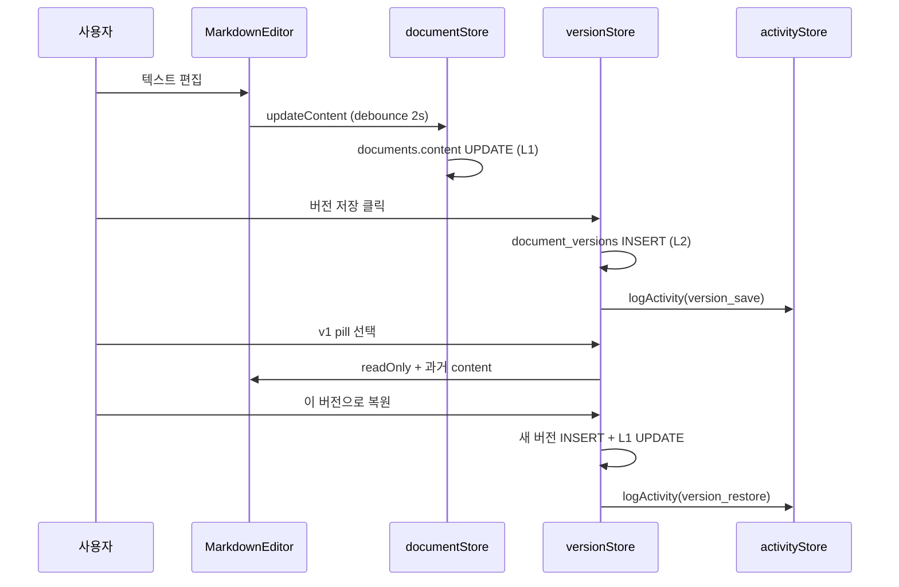
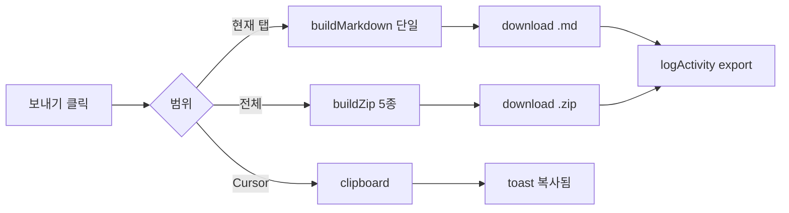

# PlanOS — 화면별 히스토리 관리 & 파일보내기 설계서

> 작성일: 2026.06.10 · **갱신: 2026.06.12**  
> 기준: `TECH_SPEC.md`, `PlanOS_기획서_v3.0`, 현재 Supabase 구현  
> 상태: **E1~E3 구현 완료** (E4~E9·V1.2 UI 일부 미구현)

### 관련 문서

| 문서 | 역할 |
|------|------|
| [`TECH_SPEC.md`](./TECH_SPEC.md) | 전체 기술 명세 |
| [`DEV_GUIDE.md`](./DEV_GUIDE.md) | 구현 우선순위·역할 분담 |
| **이 문서** | 히스토리·보내기 상세 설계 |

---

## 1. 설계 목표

| 목표 | 설명 |
|------|------|
| **추적 가능성** | 누가·언제·무엇을 바꿨는지 화면별로 확인 |
| **복구 가능성** | 산출물은 명시적 버전으로 되돌리기 (기존 정책 유지) |
| **이식성** | Markdown 중심으로 외부 도구(Cursor, Notion 등)로 가져가기 |
| **일관성** | 8개 화면 각각 「히스토리가 있는가 / 없는가」를 명확히 정의 |
| **점진 구현** | MVP는 DOC-001 중심, 나머지는 최소·V2 확장 |

---

## 2. 용어 정리

PlanOS에서 「히스토리」는 **한 가지가 아니라 4계층**으로 나뉩니다.

```
┌─────────────────────────────────────────────────────────┐
│ L4  활동 로그 (Activity Log)     — 프로젝트·화면 이벤트   │
├─────────────────────────────────────────────────────────┤
│ L5  멤버 코멘트 (Member Comments) — 팀 리뷰·피드백       │  → MEMBER_COMMENTS_DESIGN.md
├─────────────────────────────────────────────────────────┤
│ L3  대화 이력 (Chat History)     — AI 채팅 메시지        │
├─────────────────────────────────────────────────────────┤
│ L2  명시적 버전 (Document Version) — 사용자「버전 저장」  │
├─────────────────────────────────────────────────────────┤
│ L1  현재 본문 (Live Content)      — 자동저장 대상         │
└─────────────────────────────────────────────────────────┘
```

| 계층 | 저장소 | 생성 시점 | 복구 방식 |
|------|--------|----------|----------|
| L1 현재 본문 | `documents.content` | 편집·채팅·재생성·복원 | 항상 최신 (자동저장 2초) |
| L2 명시적 버전 | `document_versions` | 「버전 저장」·복원 시 새 버전 | pill 선택 → 읽기전용 → 복원 |
| L3 대화 이력 | `chat_messages` | AI 채팅 전송 | 읽기 전용 (문서 수정의 근거) |
| L4 활동 로그 | `project_activities` *(신규)* | 생성·재생성·보내기·멤버 등 | 감사·타임라인 (복구 아님) |

**원칙 (기존 TECH_SPEC 6.2 유지)**

- 자동저장(L1)과 버전 저장(L2)은 **분리** — 자동저장은 `documents`만 UPDATE.
- 복원은 기존 버전 삭제 없이 **새 버전 생성** + L1 갱신.
- L4는 감사 목적이며, L2를 대체하지 않음.

---

## 3. 화면별 히스토리·보내기 매트릭스

### 3.1 요약표

| 화면 | 코드 | 히스토리 (L1~L4) |보내기 | MVP | 비고 |
|------|------|------------------|----------|-----|------|
| 랜딩 | LAND-001 | L4(세션) only | 미리보기 MD | V1.1 | 로그인 전 sessionStorage |
| 로그인 | AUTH-001 | — | — | — | 인증 이벤트는 V2 |
| 온보딩 | AUTH-002 | — | — | — | 1회성 |
| 대시보드 | DASH-001 | L4(프로젝트 요약) | — | V1.2 | 카드 `updated_at` |
| 프로젝트 목록 | PROJ-001 | L4(동일) | — | V1.2 | |
| 프로젝트 생성 | PROJ-002 | L3(인터뷰)·L4(생성 run) | — | V1.2 | 인터뷰 답변 보관 |
| **산출물 편집** | **DOC-001** | **L1~L5 전체** | **MD/ZIP** | **V1.0** | **핵심** · L5 코멘트는 C1 |
| 설정 | SET-001 | L4(계정) | — | V2 | AI 사용량 이력 |

### 3.2 화면별 상세

#### LAND-001 — 랜딩 + 비로그인 체험

| 항목 | 설계 |
|------|------|
| 히스토리 | `sessionStorage`: `planos_guest_idea`, `planos_guest_interview`, `planos_guest_result` |
| 보존 기간 | 브라우저 탭 세션 (로그인 이관 시 `clearGuestSession`) |
| UI | 「다시 시도」로 세션 초기화; 별도 히스토리 패널 없음 |
|보내기 | **V1.1** 미리보기 화면에 「Markdown 복사」/「5종 ZIP」 (로그인 없이 로컬 다운로드) |
| 제한 | 비로그인 1회 체험 정책 유지 |

#### AUTH-001 / AUTH-002

| 항목 | 설계 |
|------|------|
| 히스토리 | 없음 (MVP) |
| V2 | `auth_events` — 로그인·로그아웃 감사 (관리자용) |

#### DASH-001 / PROJ-001 — 대시보드·프로젝트 목록

| 항목 | 설계 |
|------|------|
| 히스토리 | 프로젝트 카드 `updated_at` + **V1.2** 마지막 활동 1줄 요약 (`memory_summary` 또는 L4 최신 이벤트) |
| UI | 카드 하단 「최근 수정: 6월 8일」; 클릭 시 DOC-001 |
|보내기 | 없음 (프로젝트 단위보내기는 DOC-001에서) |
| 컨텍스트 메뉴 | **V1.2** 「프로젝트보내기 (ZIP)」 추가 검토 |

#### PROJ-002 — 프로젝트 생성 + AI 인터뷰

| 항목 | 설계 |
|------|------|
| L3 | `interview_answers` — 프로젝트에 스냅샷 저장 *(신규 컬럼 또는 JSON)* |
| L4 | `generation_runs` — 5단계 파이프라인 실행 기록 *(신규 테이블)* |
| UI | 생성 완료 후 「인터뷰 답변 보기」접이식 (DOC 사이드바 또는 프로젝트 설정) |
|보내기 | 없음 (생성 직후 DOC-001으로 이동) |
| 취소 시 | 완료 단계까지 L1·L4에 partial run 기록 (기존 정책) |

#### DOC-001 — 산출물 편집 + AI 채팅 *(핵심)*

| 항목 | 설계 |
|------|------|
| L1 | `documentStore` 자동저장 (구현됨) |
| L2 | `VersionPills` + 버전 저장/복원 (구현됨) |
| L3 | `ChatPanel` 메시지 목록 (구현됨) |
| L4 | `ActivityTimeline` — 재생성·보내기·멤버 초대 등 |
| L5 | **C1** `CommentPanel` — 멤버 코멘트·답글·해결 ([`MEMBER_COMMENTS_DESIGN.md`](./MEMBER_COMMENTS_DESIGN.md)) |
|보내기 | **V1.0** 단일 MD, **V1.0** 프로젝트 ZIP, **V2** PDF |

**DOC-001 UI 구조 (제안)**

```
DocumentToolbar
├── [현재] [v1] [v2] ...          ← L2 VersionPills (기존)
├── [히스토리 ▾]                  ← 신규: L2+L3+L4 통합 패널
├── [보내기 ▾]                  ← 신규: ExportMenu
├── 재생성 | 버전 저장 | 저장상태
```

**「히스토리」통합 패널 탭**

| 탭 | 내용 | 데이터 소스 |
|----|------|------------|
| 버전 | v1, v2… 목록·날짜·이름·미리보기 | `document_versions` |
| 채팅 | 해당 문서 AI 대화 | `chat_messages` |
| 활동 | 재생성·보내기·복원 이벤트 | `project_activities` |

#### SET-001 — 설정

| 항목 | 설계 |
|------|------|
| 히스토리 | **V2** 「AI 사용 내역」타임라인 (월별 생성·채팅·재생성 횟수) |
|보내기 | **V2** 계정 데이터보내기 (GDPR 스타일 JSON) |

---

## 4. 파일보내기 설계

### 4.1 지원 포맷 & Phase

> **형식 확장 상세**: [`EXPORT_FORMATS_DESIGN.md`](./EXPORT_FORMATS_DESIGN.md) — HTML·JSON·PDF·DOCX·권한·UI·파이프라인

| 포맷 | 범위 | Phase | 구현 방식 | 상태 |
|------|------|-------|----------|------|
| **Markdown (.md)** | 단일 산출물 | E1 | 클라이언트 Blob | ✅ |
| **ZIP (.zip)** | 프로젝트 5종 + README | E1 | JSZip | ✅ |
| **클립보드** | Cursor 프롬프트 탭 | E1 | `navigator.clipboard` | ✅ |
| **HTML (.html)** | 단일·번들 | E6 | `marked` → standalone HTML | 설계 |
| **TXT (.txt)** | 단일 | E6 | MD strip | 설계 |
| **JSON (.json)** | 프로젝트 백업 | E6 | ExportSource 직렬화 | 설계 |
| **PDF (.pdf)** | 단일·전체 | E7 | print CSS → EF Puppeteer | 설계 |
| **DOCX (.docx)** | 단일 | E8 | `docx` npm | 설계 |
| **Notion / Google Docs** | — | E9 | OAuth 연동 | 설계 |

### 4.2 파일명 규칙

```
단일:  {프로젝트명}_{산출물타입}_{YYYYMMDD}.md
       예: 반려동물케어앱_PRD_20260610.md

ZIP:   {프로젝트명}_PlanOS_{YYYYMMDD}.zip
       ├── README.md          (프로젝트 메타·생성일)
       ├── prd.md
       ├── ia.md
       ├── screen-list.md
       ├── policy.md
       └── cursor-prompt.md
```

### 4.3 ZIP 내부 README.md 템플릿

```markdown
# {프로젝트명}

- 서비스 유형: {service_type}
- 목표 사용자: {target_user}
-보내기 일시: {exported_at}
- PlanOS 버전: {app_version}

## 포함 산출물

| 파일 | 설명 |
|------|------|
| prd.md | 제품 요구사항 문서 |
| ...
```

### 4.4 화면별보내기 진입점

| 화면 | 진입점 | 옵션 |
|------|--------|------|
| DOC-001 툴바 | `보내기 ▾` 드롭다운 | 현재 탭 MD / 전체 ZIP / (Cursor만) 복사 |
| DOC-001 히스토리 | 버전 행 `↓` 아이콘 | 해당 버전 스냅샷 MD |
| LAND-001 미리보기 | `결과 다운로드` | 5종 ZIP (게스트) |
| PROJ-001 컨텍스트 | `프로젝트보내기` | ZIP (V1.2) |

### 4.5 권한 & 플랜

| 역할 | 단일 MD | ZIP | PDF |
|------|---------|-----|-----|
| owner | ✅ | ✅ | V2 |
| editor | ✅ | ✅ | V2 |
| viewer | ✅ | ❌ | V2 |
| guest (랜딩) | ✅ (체험 결과만) | ✅ | — |

| 플랜 | 일일보내기 횟수 (제안) |
|------|---------------------------|
| free | 10회 |
| pro | 무제한 |
| team | 무제한 + 감사 로그 |

> MVP(Mock): 횟수 제한 UI만, enforcement는 V2.

### 4.6보내기 시 L4 활동 로그

보내기 성공 시 `project_activities`에 기록:

```json
{
  "action": "export",
  "meta": { "format": "zip", "doc_types": ["prd","ia",...] }
}
```

---

## 5. 데이터 모델 (신규·확장)

### 5.1 `project_activities` (신규)

```sql
create table public.project_activities (
  id uuid primary key default gen_random_uuid(),
  project_id uuid not null references public.projects(id) on delete cascade,
  user_id uuid references public.users(id) on delete set null,
  document_id uuid references public.documents(id) on delete set null,
  action text not null check (action in (
    'create', 'update', 'version_save', 'version_restore',
    'regenerate', 'regenerate_cascade', 'chat', 'export',
    'member_invite', 'member_remove', 'pipeline_complete', 'pipeline_cancel'
  )),
  meta jsonb not null default '{}',
  created_at timestamptz not null default now()
);

create index project_activities_project_id_idx on public.project_activities (project_id);
create index project_activities_created_at_idx on public.project_activities (project_id, created_at desc);
```

### 5.2 `generation_runs` (V1.2)

```sql
create table public.generation_runs (
  id uuid primary key default gen_random_uuid(),
  project_id uuid not null references public.projects(id) on delete cascade,
  status text not null check (status in ('running', 'completed', 'cancelled', 'failed')),
  completed_steps text[] not null default '{}',
  interview_answers jsonb,
  started_at timestamptz not null default now(),
  finished_at timestamptz
);
```

**RLS (적용됨, `003_generation_runs_rls.sql`):** 정책 `본인 generation_runs만` — `FOR ALL`, `auth.uid() = projects.user_id`.

### 5.3 `projects` 확장

```sql
alter table public.projects
  add column if not exists interview_answers jsonb not null default '{}';
```

### 5.4 `document_versions` 확장 (선택)

```sql
alter table public.document_versions
  add column if not exists created_by uuid references public.users(id),
  add column if not exists source text check (source in ('manual', 'restore', 'regenerate', 'chat'));
```

### 5.5 TypeScript 타입 (신규)

```typescript
export type ActivityAction =
  | 'create' | 'update' | 'version_save' | 'version_restore'
  | 'regenerate' | 'regenerate_cascade' | 'chat' | 'export'
  | 'member_invite' | 'member_remove'
  | 'pipeline_complete' | 'pipeline_cancel'

export interface ProjectActivity {
  id: string
  project_id: string
  user_id: string | null
  document_id: string | null
  action: ActivityAction
  meta: Record<string, unknown>
  created_at: string
}

export type ExportFormat =
  | 'md' | 'html' | 'txt' | 'pdf' | 'docx'
  | 'zip' | 'json' | 'html_bundle'
  | 'clipboard' | 'print_preview'
  // E9: 'notion' | 'google_docs'
export type ExportScope = 'current_doc' | 'current_version' | 'all_docs' | 'guest_preview'
// 상세: EXPORT_FORMATS_DESIGN.md
```

---

## 6. API & Store 설계

### 6.1 API 레이어

| 파일 | 역할 |
|------|------|
| `lib/api/activities.ts` | 활동 로그 CRUD (조회·기록) |
| `lib/api/export.ts` |보내기 메타·횟수 (서버 enforcement V2) |
| `lib/export/buildMarkdown.ts` | MD 문자열 생성 (클라이언트) |
| `lib/export/buildZip.ts` | ZIP Blob 생성 (JSZip) |
| `lib/export/download.ts` | `URL.createObjectURL` + anchor click |

**활동 기록 (공통 헬퍼)**

```typescript
// lib/api/activities.ts
export async function logActivity(input: {
  project_id: string
  document_id?: string
  action: ActivityAction
  meta?: Record<string, unknown>
}): Promise<void>
```

기록 호출 위치: `versionStore.saveVersion`, `documentStore.regenerate`, `memberStore.inviteMember`, export 성공 콜백 등.

### 6.2 Store

| Store | 추가 상태·액션 |
|-------|----------------|
| `activityStore` *(신규)* | `activities`, `fetchActivities(projectId, filter?)` |
| `versionStore` | `saveVersion` 시 `source: 'manual'` 메타 |
| `exportStore` *(신규)* | `exportDocument`, `exportProjectZip`, `copyToClipboard`, `isExporting` |
| `uiStore` | `openHistoryPanel`, `openExportMenu` (선택) |

### 6.3 Edge Function (V2)

| Function | 용도 |
|----------|------|
| `export-pdf` | 서버사이드 PDF 렌더 (Puppeteer/playwright) |
| `export-audit` | 대용량 ZIP·팀 감사보내기 |

MVP는 **클라이언트 전용** — API 키·서버 불필요.

---

## 7. UI 컴포넌트 (신규)

| 컴포넌트 | 파일 | 역할 |
|---------|------|------|
| `HistoryPanel` | `document/HistoryPanel.tsx` | 탭: 버전 / 채팅 / 활동 |
| `ActivityTimeline` | `document/ActivityTimeline.tsx` | L4 타임라인 UI |
| `VersionListItem` | `document/VersionListItem.tsx` | 버전 행 +보내기 아이콘 |
| `ExportMenu` | `document/ExportMenu.tsx` | 드롭다운: MD / ZIP / 복사 |
| `ExportModal` | `document/ExportModal.tsx` | ZIP 진행·완료 (선택) |

**`DocumentToolbar` 변경**

```
기존: VersionPills | 재생성 | 버전저장 | SaveStatus
추가: [히스토리] [보내기 ▾]  (VersionPills 유지 또는 히스토리 패널로 통합)
```

---

## 8. 플로우 다이어그램

### 8.1 버전 히스토리 (기존 + 확장)



### 8.2보내기



---

## 9. 구현 Phase

### Phase E1 — DOC-001보내기 ✅

- [x] `lib/export/buildMarkdown.ts`, `download.ts`
- [x] `ExportMenu` 컴포넌트
- [x] 단일 MD + 프로젝트 ZIP
- [x] Cursor 프롬프트 「클립보드 복사」
- [x] `package.json`에 `jszip` 추가

### Phase E2 — DOC-001 히스토리 통합 패널 ✅

- [x] `activityStore` + Supabase `project_activities`
- [x] `HistoryPanel` (버전·채팅·활동 탭)
- [x] 주요 액션에서 `logActivity` 호출
- [x] 버전별 MD보내기

### Phase E3 — 랜딩·프로젝트 확장 (1일)

- [x] LAND-001 게스트 ZIP 다운로드
- [x] PROJ-002 `interview_answers` 프로젝트 저장 (DB + API)
- [x] `generation_runs` Supabase 기록 + RLS (`003`)
- [ ] PROJ-002 인터뷰 답변 **조회 UI** (V1.2)

### Phase E4 — Supabase 연동 (백엔드 후)

- [x] `project_activities` 마이그레이션·RLS (`001`)
- [x] `activities.ts` Supabase 연동
- [ ]보내기 횟수 enforcement (free 일 10회)

### Phase E5 — V2 (기존)

- [ ]보내기 횟수 DB enforcement
- [ ] 설정 AI 사용 내역
- [ ] 계정 데이터 JSON보내기 (GDPR)

### Phase E6~E9 — 형식 확장

→ [`EXPORT_FORMATS_DESIGN.md`](./EXPORT_FORMATS_DESIGN.md) 참조

- **E6** HTML · TXT · JSON + `ExportModal`
- **E7** PDF · `html_bundle`
- **E8** DOCX
- **E9** Notion · Google Docs 연동

---

## 10. 현재 구현 vs 갭

| 기능 | 현재 | 비고 |
|------|------|------|
| L1 자동저장 | ✅ | `documentStore` debounce 2초 |
| L2 버전 pills/복원 | ✅ | + `SaveVersionModal` (`version_name`) |
| L3 채팅 이력 | ✅ | `HistoryPanel` 탭 |
| L4 활동 로그 | ✅ | `project_activities` + `activities.ts` |
| 단일 MD보내기 | ✅ | `DocumentPage` export |
| ZIP보내기 | ✅ | `buildProjectZip` |
| 랜딩보내기 | ✅ | LAND-001 게스트 ZIP |
| 인터뷰 답변 보관 | ✅ DB | 조회 UI만 미구현 (E3) |
| PDF/HTML/DOCX | ❌ | E6~E9 |

---

## 11. AI 작업 지시 예시

```
「Phase E1보내기 구현해줘」     → DOC-001 MD/ZIP/클립보드
「히스토리 패널 구현해줘」         → Phase E2
「활동 로그 DB 마이그레이션해줘」 → Phase E4
```

---

## 12. 의사결정 필요 (서아 확인)

| # | 항목 | 제안 | 대안 |
|---|------|------|------|
| 1 | VersionPills vs 히스토리 패널 | pills 유지 + 히스토리는 상세 패널 | pills를 패널 안으로 완전 이동 |
| 2 | ZIP에 채팅/활동 로그 포함 | MVP는 MD 5종만 | `activity.json` 추가 |
| 3 | Free보내기 제한 | 일 10회 | 무제한 (mock) |
| 4 | PDF 우선순위 | V2 | E1 직후 클라이언트 print |

---

*이 설계서 확정 후 `TECH_SPEC.md` 섹션 2·4·5에 컴포넌트·API·DB 항목을 반영합니다.*
