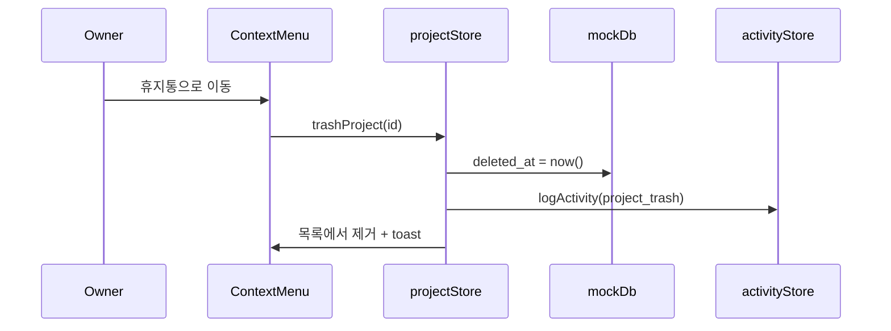
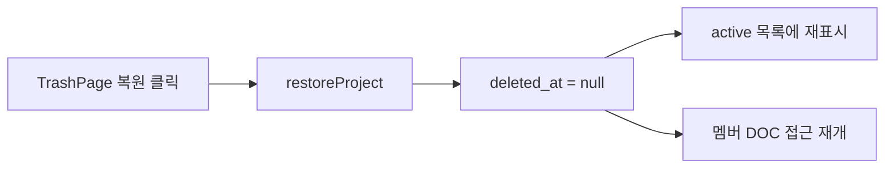

# PlanOS — 프로젝트 휴지통 설계서

> 작성일: 2026.06.10  
> 상태: **T1 Supabase Real API ✅** (T2~T4 미구현)  
> 연관: [`TECH_SPEC.md`](./TECH_SPEC.md), [`MEMBER_PERMISSIONS_DESIGN.md`](./MEMBER_PERMISSIONS_DESIGN.md), [`DEV_GUIDE.md`](./DEV_GUIDE.md)

---

## 1. 배경 & 문제

### 1.1 T1 구현 후 (현재)

| 항목 | 현재 동작 | 비고 |
|------|----------|------|
| 컨텍스트 메뉴 | 「휴지통으로 이동」→ soft delete | T1 ✅ |
| 확인 모달 | 휴지통 이동 안내 문구 | T1 ✅ |
| 휴지통 UI | `/projects/trash` — 복원·영구삭제 | T1 ✅ |
| 멤버 프로젝트 | owner만 이동, DOC 접근 차단 | T1 ✅ |
| GNB 뱃지·비우기 | 미구현 | T2 |
| 30일 자동 purge | EF 미구현 | T4 |

### 1.2 목표

| 목표 | 설명 |
|------|------|
| **안전한 삭제** | 삭제 = 휴지통 이동 (soft delete), 30일 유예 |
| **복구** | 소유자가 휴지통에서 복원 |
| **영구 삭제** | 휴지통에서만 「영구 삭제」 (hard delete) |
| **플랜 연동** | 휴지통 프로젝트는 생성 한도에서 제외 |
| **멤버 정책** | 휴지통 이동 시 멤버 접근 즉시 차단 |

### 1.3 비목표 (MVP)

- 휴지통 항목별 부분 복구 (문서만 복구)
- 팀 워크스페이스 공용 휴지통
- 삭제 승인 워크플로 (editor가 삭제 요청 → owner 승인)

---

## 2. 삭제 3단계 모델

```
┌─────────────┐    휴지통 이동     ┌─────────────┐   영구 삭제    ┌─────────────┐
│   active    │ ───────────────► │   trashed   │ ─────────────► │   purged    │
│  (정상 목록) │ ◄─────────────── │  (휴지통)    │   (30일 자동)   │  (DB 제거)   │
└─────────────┘      복원         └─────────────┘                └─────────────┘
```

| 단계 | 코드 | `deleted_at` | 목록 노출 | 데이터 |
|------|------|--------------|----------|--------|
| 정상 | `active` | `NULL` | DASH / PROJ | 전체 |
| 휴지통 | `trashed` | `NOT NULL` | 휴지통만 | 보존 (읽기 전용) |
| 영구 삭제 | `purged` | — | 없음 | cascade hard delete |

**자동 영구 삭제**: `deleted_at + 30일` 경과 시 배치(Edge Function / cron)가 purge.

---

## 3. 화면별 UI 설계

### 3.1 화면 매트릭스

| 화면 | 코드 | 휴지통 관련 UI | Phase |
|------|------|---------------|-------|
| 대시보드 | DASH-001 | 컨텍스트 「휴지통으로 이동」 | T1 |
| 프로젝트 목록 | PROJ-001 | 동일 + 상단 **휴지통** 링크 | T1 |
| **휴지통** | **TRASH-001** | **신규 화면** — 목록·복원·영구삭제 | T1 |
| 산출물 편집 | DOC-001 | 휴지통 프로젝트 URL 접근 시 차단 | T1 |
| 설정 | SET-001 | 휴지통 자동 삭제 안내 (선택) | T2 |
| GNB | — | `프로젝트` 옆 휴지통 아이콘 + 개수 뱃지 | T1 |

### 3.2 라우팅 (신규)

```
/projects/trash   → TRASH-001  TrashPage  [Protected, owner 휴지통]
```

기존 `/projects`, `/dashboard`는 **active** 프로젝트만 표시.

### 3.3 컨텍스트 메뉴 변경

| 기존 | 변경 후 |
|------|---------|
| 삭제 (danger) | **휴지통으로 이동** (danger) |

**ConfirmModal 문구 (변경)**

```
제목: 프로젝트를 휴지통으로 이동
본문: 프로젝트가 휴지통으로 이동합니다. 30일 이내 복원할 수 있으며,
      멤버의 접근이 즉시 중단됩니다.
확인: 휴지통으로 이동
```

### 3.4 TRASH-001 — 휴지통 화면

```
┌────────────────────────────────────────────────────────────┐
│  휴지통                                    [비우기] (T2)    │
│  30일 후 자동으로 영구 삭제됩니다.                           │
├────────────────────────────────────────────────────────────┤
│  [검색]                                                     │
├────────────────────────────────────────────────────────────┤
│  ┌──────────────────────────────────────────────────────┐  │
│  │ 반려동물 케어 앱                                        │  │
│  │ 삭제: 6월 8일 · 22일 후 영구 삭제                       │  │
│  │                              [복원]  [영구 삭제]        │  │
│  └──────────────────────────────────────────────────────┘  │
│  ...                                                        │
├────────────────────────────────────────────────────────────┤
│  휴지통이 비어 있습니다.                                    │
└────────────────────────────────────────────────────────────┘
```

| 액션 | 권한 | 동작 |
|------|------|------|
| 복원 | `project.restore` (owner) | `deleted_at = NULL`, 멤버 접근 재개 |
| 영구 삭제 | `project.purge` (owner) | hard delete (기존 `deleteProject`) |
| 휴지통 비우기 | `project.purge` | trashed 전체 purge (T2, 확인 2단계) |

**카드 정보**

- 프로젝트명 · 서비스 유형
- `deleted_at` (휴지통 이동 시각)
- `days_until_purge` = 30 - (now - deleted_at) 일

### 3.5 DOC-001 접근 차단

휴지통 프로젝트 URL 직접 접근 시:

```
EmptyState: 「이 프로젝트는 휴지통에 있습니다」
[휴지통에서 복원] (owner) / [휴지통으로 이동] (링크)
```

---

## 4. 권한 설계

### 4.1 Permission 확장

```typescript
type TrashPermission =
  | 'project.trash'    // 휴지통 이동 (기존 project.delete 대체)
  | 'project.restore'  // 복원
  | 'project.purge'    // 영구 삭제
```

| 권한 | owner | editor | viewer |
|------|:-----:|:------:|:------:|
| project.trash | ✅ | ❌ | ❌ |
| project.restore | ✅ | ❌ | ❌ |
| project.purge | ✅ | ❌ | ❌ |

> **하위 호환**: `project.delete` → `project.trash` alias (기존 코드 점진 마이그레이션).

### 4.2 멤버 프로젝트 정책

| 이벤트 | 멤버(editor/viewer) | owner |
|--------|---------------------|-------|
| 휴지통 이동 | 목록·DOC 접근 **즉시 차단** | 휴지통에서 관리 |
| 복원 | 접근 **재개** (`status=active` 멤버만) | 정상 목록 복귀 |
| 영구 삭제 | — | 데이터 전부 삭제 |

**알림 (T3)**: 휴지통 이동 시 멤버에게 인앱 알림 「{프로젝트}가 휴지통으로 이동되었습니다」.

---

## 5. 플랜 & 한도

| 플랜 | active 프로젝트 한도 | 휴지통 한도 | 자동 purge |
|------|---------------------|------------|-----------|
| free | 3개 | 10개 | 30일 |
| pro | 무제한 | 50개 | 30일 |
| team | 무제한 | 100개 | 60일 (선택) |

- **생성 한도**: `canCreateProject(count)`는 **active만** 카운트.
- 휴지통 10개 초과 시: 「휴지통을 비운 후 이동하세요」 toast.

---

## 6. 데이터 모델

### 6.1 `projects` 확장

```sql
alter table public.projects
  add column if not exists deleted_at timestamptz,
  add column if not exists deleted_by uuid references public.users(id) on delete set null;

create index projects_user_active_idx
  on public.projects (user_id, updated_at desc)
  where deleted_at is null;

create index projects_user_trashed_idx
  on public.projects (user_id, deleted_at desc)
  where deleted_at is not null;
```

### 6.2 TypeScript

```typescript
export interface Project {
  // ... 기존 필드
  deleted_at: string | null
  deleted_by: string | null
}

export type ProjectLifecycle = 'active' | 'trashed'

export function getProjectLifecycle(p: Project): ProjectLifecycle {
  return p.deleted_at ? 'trashed' : 'active'
}

export interface TrashedProject extends Project {
  deleted_at: string
  days_until_purge: number
}
```

### 6.3 Supabase DB

`projects.deleted_at` / `deleted_by` — `001_initial_schema.sql`. API: `projects.ts` (`trashProject`, `restoreProject`, `purgeProject`).

| 함수 | 변경 |
|------|------|
| `getProjects(userId)` | `deleted_at IS NULL` 필터 |
| `getTrashedProjects(userId)` | `deleted_at IS NOT NULL` |
| `trashProject(id, userId)` | `deleted_at = now()`, `deleted_by` |
| `restoreProject(id)` | `deleted_at = null` |
| `deleteProject(id)` | **purge** — 기존 hard delete 유지 (휴지통에서만 호출) |

### 6.4 RLS (Supabase)

```sql
-- active 목록: 본인 소유 active OR active 멤버
create policy "projects_select_active" on public.projects
  for select using (
    deleted_at is null
    and (
      user_id = auth.uid()
      or exists (
        select 1 from public.project_members pm
        where pm.project_id = projects.id
          and pm.user_id = auth.uid()
          and pm.status = 'active'
      )
    )
  );

-- 휴지통: 소유자만
create policy "projects_select_trashed" on public.projects
  for select using (
    deleted_at is not null
    and user_id = auth.uid()
  );

-- trash: owner만
create policy "projects_trash" on public.projects
  for update using (user_id = auth.uid() and deleted_at is null)
  with check (deleted_at is not null);

-- restore: owner만
create policy "projects_restore" on public.projects
  for update using (user_id = auth.uid() and deleted_at is not null)
  with check (deleted_at is null);
```

---

## 7. API & Store

### 7.1 API (`lib/api/projects.ts`)

```typescript
fetchProjects(userId): Promise<Project[]>           // active only
fetchTrashedProjects(userId): Promise<TrashedProject[]>

trashProject(id: string): Promise<Project>          // soft delete
restoreProject(id: string): Promise<Project>
purgeProject(id: string): Promise<void>           // hard delete

// deprecated alias
deleteProject → trashProject (T1) / purgeProject (명시적)
```

### 7.2 `projectStore` 확장

```typescript
interface ProjectState {
  projects: Project[]           // active
  trashedProjects: TrashedProject[]
  trashCount: number

  fetchProjects: () => Promise<void>
  fetchTrashedProjects: () => Promise<void>
  trashProject: (id: string) => Promise<void>
  restoreProject: (id: string) => Promise<void>
  purgeProject: (id: string) => Promise<void>
}
```

### 7.3 활동 로그 (L4)

| action | meta |
|--------|------|
| `project_trash` | `{ project_id, title }` |
| `project_restore` | `{ project_id, title }` |
| `project_purge` | `{ project_id, title }` |

`ActivityAction` 타입에 3개 추가.

---

## 8. UI 컴포넌트 (신규·변경)

| 컴포넌트 | 파일 | 역할 |
|---------|------|------|
| `TrashPage` | `pages/TrashPage.tsx` | TRASH-001 |
| `TrashedProjectCard` | `project/TrashedProjectCard.tsx` | 휴지통 카드 + D-day |
| `TrashEmptyState` | `project/TrashEmptyState.tsx` | 빈 휴지통 |
| `ProjectActionModals` | *(변경)* | 삭제 → 휴지통 이동 문구 |
| `ProjectCardItem` | *(변경)* | 메뉴 라벨 변경 |
| `GlobalNavBar` | *(변경)* | 휴지통 링크 + 뱃지 |

### 8.1 `useProjectActions` 변경

```typescript
// deleteTarget → trashTarget
handleTrash: () => trashProject(trashTarget)
handleRestore: (id) => restoreProject(id)
handlePurge: (id) => purgeProject(id)
```

---

## 9. 플로우

### 9.1 휴지통 이동



### 9.2 복원



### 9.3 자동 purge (T4 — Supabase)

```sql
-- Edge Function: purge-expired-trash (일 1회)
delete from public.projects
where deleted_at < now() - interval '30 days';
```

---

## 10. 구현 Phase

### Phase T1 — 핵심 ⭐ ✅

- [x] `Project.deleted_at` / `deleted_by` — DB (`001`) + `projects.ts`
- [x] `trashProject` / `restoreProject` / `purgeProject` API (Supabase Real)
- [x] `projectStore` trashed 상태
- [x] `TrashPage` + 라우트 `/projects/trash`
- [x] 컨텍스트 메뉴·ConfirmModal 문구 변경
- [x] `fetchProjects` active 필터
- [x] DOC-001 휴지통 접근 차단
- [x] `project.trash` / `restore` / `purge` 권한
- [x] 플랜 한도 active만 카운트
- [x] `logActivity(project_trash|restore|purge)`

### Phase T2 — UX 보강

- [ ] GNB 휴지통 뱃지
- [x] 휴지통 검색 (`TrashPage` 클라이언트 필터)
- [ ] 휴지통 정렬 (삭제일)
- [ ] 휴지통 비우기 (전체 purge)
- [ ] SET-001 휴지통 정책 안내

### Phase T3 — 멤버 알림

- [ ] 휴지통 이동 시 멤버 toast/알림
- [ ] 멤버 목록에서 trashed 프로젝트 제외 확인

### Phase T4 — Supabase

- [x] 마이그레이션 `deleted_at` / `deleted_by` (`001`)
- [x] RLS — 멤버 접근 (`006`)
- [ ] `purge-expired-trash` Edge Function

---

## 11. 에러·엣지 케이스

| 상황 | 처리 |
|------|------|
| 휴지통 가득 참 | 이동 거부 + 「휴지통 비우기」 링크 |
| 복원 시 제목 중복 | 허용 (ID가 고유) |
| 복원 후 멤버 pending | pending 유지, active만 접근 |
| editor가 삭제 시도 | 메뉴 비표시 / 권한 거부 |
| 휴지통 URL 북마크 | DOC 차단 + 복원 CTA |
| 동시 trash + 편집 | trash 시 자동저장 flush 후 이동 |
| owner 계정 삭제 | cascade purge (기존 정책) |

---

## 12. 의사결정 (서아 확인)

| # | 항목 | 제안 | 대안 |
|---|------|------|------|
| 1 | 삭제 = soft delete | 휴지통 이동 | 유지 + 5초 undo toast |
| 2 | 보존 기간 | 30일 | 7일 / 90일 |
| 3 | 휴지통 화면 | `/projects/trash` 전용 | PROJ-001 탭 |
| 4 | 메뉴 문구 | 「휴지통으로 이동」 | 「삭제」유지 + 설명 보강 |
| 5 | 한도 | active만 카운트 | 휴지통 포함 |

---

## 13. 문서 체크리스트

- [x] `TECH_SPEC.md` — TRASH-001 화면·라우트·API
- [x] `MEMBER_PERMISSIONS_DESIGN.md` — trash/restore/purge
- [x] `DEV_GUIDE.md` — Phase T1~T4
- [x] `MOCK_GAP_REVIEW.md` — 삭제 → 휴지통 갭 반영

---

*구현 지시: 「Phase T1 휴지통 구현해줘」*
