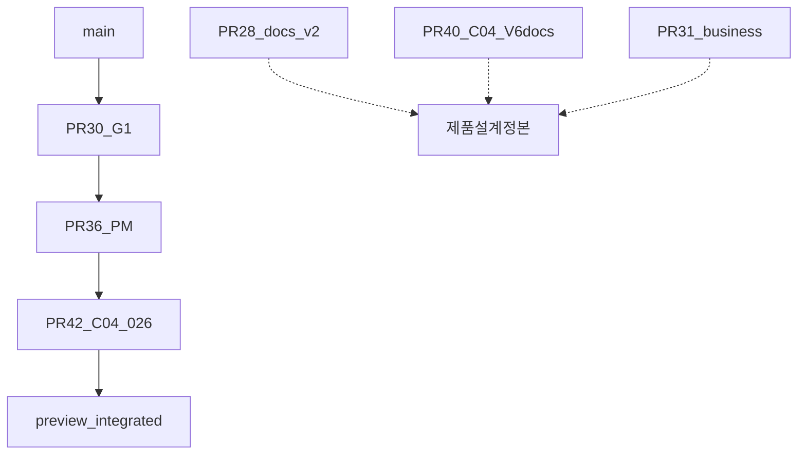
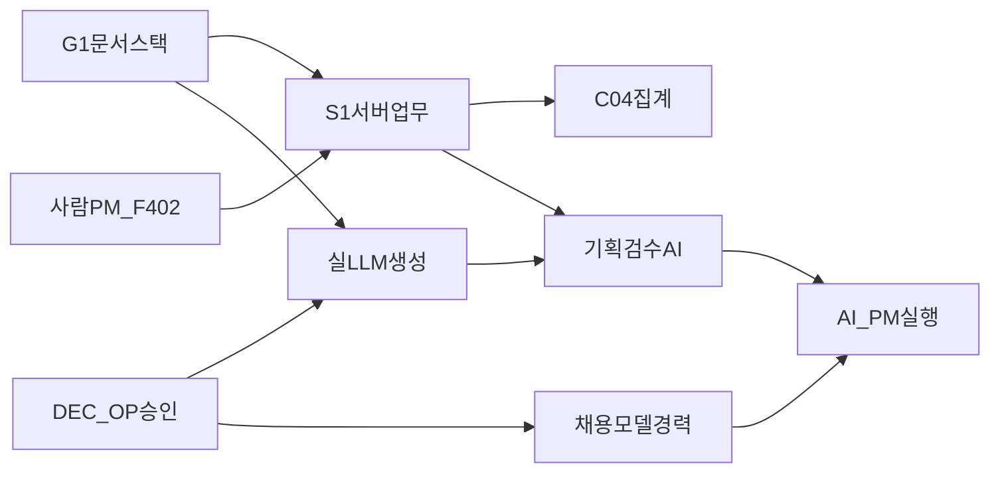

# PlanOS 의존성 · 실행 순서 로드맵 (2026-10-23)

## 1. Git / PR 계보

| 순서 | PR | HEAD(보고시점) | base | 비고 |
|---|---|---|---|---|
| 1 | #30 | `f74481e` | main | Sonar security 차단 |
| 2 | #36 | `cb32c91` | #30 브랜치 | Sonar 중복 차단 |
| 3 | #42 | `716f9e6`+ | #36 브랜치 | CI·Sonar OK; 026 포함 |
| tip | preview | `7460e5b` | (통합 tip) | Preview 배포 소스 |

**규칙:** tip만 고쳐 Sonar #30/#36 게이트가 자동 해소되지 않음. 각 PR 브랜치에 수정 커밋 필요.  
구 Draft #22~#27 G1/Mock은 #30/#36에 흡수·대체된 항목이 많음 → 중복 병합 금지.

## 2. DB 마이그레이션 의존

| 대역 | 파일 | 의존 | 운영 |
|---|---|---|---|
| 기반 | 001~008, 011~012 | — | 미확인 |
| G1 | 013~016, 018~020 | 순서 준수 | 미적용 가능 |
| PM | 022→023→024 | 022 선행 | 미적용 |
| C04 | 025 | tasks+pm | 미적용 |
| 무결성 | 026 | 014 재선언 | 미적용 |
| DRAFT | 017, 021 | **적용 금지** | — |

코드 배포는 **DB가 코드보다 앞서야** 함 (CAS 018 등). 상세: `DEPLOYMENT_TRANSITION_PLAN_2026-10-22.md` 확장.

## 3. 기능 의존 (제품)

- **사람 PM (CURRENT)** ≠ **AI PM (TARGET)** — RPC/테이블 계약 분리 후 확장.  
- 검수 AI는 문서 읽기(G1) + task 생성(S1)에 의존.  
- 채용·과금은 DEC/OP 없이 UI Mock만 허용.

## 4. 권한 · 비밀

| 계층 | 규칙 |
|---|---|
| RLS | JWT role 매트릭스 회귀 필수 (owner/editor/viewer/outsider) |
| Preview | `PlanOS-Preview` only; 운영 ref 금지 |
| LLM | 서버 사이드 키; 브라우저에 service_role·provider secret 금지 |
| 컷오버 021 | 전 클라이언트 신코드 확인 전 금지 |

## 5. 실행 순서 (고정)

1. Phase A: Sonar #30/#36 → Preview 수용 → (승인) 운영 read-only → 백업 → mig → main  
2. Phase B: S1 상세·이력·플래그 정책  
3. Phase C: LLM 어댑터 (격리 키·예산 캡)  
4. Phase D: 기획 검수 AI 세로 슬라이스  
5. Phase E: AI PM · 채용 · 경력 · 가격  
6. Phase F: 통합 게이트 · Production  

병렬 허용: 문서 동기화(#28+#40), Preview E2E, Sonar 테스트헬퍼, S1 UI 스케치(스키마 확정 전 stub).
