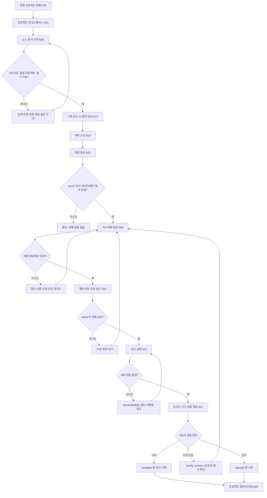

# PlanOS 3.0 — 첫 전문 AI 업무 UX 와이어플로 v0.1

**작성/최종 수정:** 2026-10-20 KST  
**상태:** Phase 1 P1-3 사용자 동선·예외·권한·화면 인계 **설계 초안**, 최종 UX·정책 승인/실제 구현·접근성 테스트 **미완료**  
**대상:** `requirements_auditor_v1` 기획 검수 AI — 프로젝트 소속 문서 2개 이상 근거 검수 및 비공개 감사 보고서.  
**근거:** [PRD](../product/PRD.md) · [첫 전문 AI 수용 조건](../product/FIRST_SPECIALIST_AI_MVP_2026-10-19.md) · [계약/비용 정책](../product/MVP_CONTRACT_APPROVAL_COST_POLICY_2026-10-19.md) · [IA](IA.md) · [화면명세](SCREEN_SPEC.md) · [TF-01~30](../product/TASK_FLOWS.md) · [권한 정책](../product/PERMISSIONS_POLICY.md).  
**환경:** TARGET 화면/가상 URL. 현행 앱에 구현된 경로가 아니며 고객 계약/외부 모델 호출은 하지 않는다. Phase 2~3 내부 최소 계약 실증과 Phase 5 고객용 인력사무소 화면을 분리한다.

## 1. 사용자 가치 및 화면 원칙
- **첫 사용자 약속:** 사용자가 작성한 PRD·IA 등 선택한 프로젝트 문서를 읽고, 서로 어긋나거나 빠진 요구사항을 **증빙이 달린 점검 보고서**로 전달한다. 정확도를 보증하지 않으며 사람 최종 검토 필수.
- **핵심 행동:** 프로젝트 진입 → 문서 2종 선택 → 권한·범위/예산·공급자 전송 고지 및 계약 동의 → PM 검사 계획 → 계획 승인 → 검사 실행 → 검증 결과 검토 → 수락/수정/반려. 이 순서를 바꾸지 않는다.
- **안전:** 미동의 모델 호출 금지, 데이터 교차 노출 금지, 문서 원본 덮어쓰기 금지, 리스크 R2/R3 도구 금지, 사용자 확인 없이 '완료' 표기 금지.
- **진행/시간:** 상태·비용은 서버 사실만 반영. 추정 시간·성공률·저장 완료를 임의로 표시하지 않는다. 닫았다 열어도 동일 run ID/상태를 다시 확인한다.
- **MVP 중복화 방지:** 보고서 **최종 수락**은 N11 상세의 검토 패널에 배치하고 N12 승인함은 해당 산출물로 연결만 한다. N13/N09는 링크/단일 승인 상세로 재사용하여 독립 저장 이벤트를 만들지 않는다.

## 2. 단계별 와이어플로 — 고객용 목표 여정

**도식 주의:** 실패 지점에서 기존 과금 발생 여부와 실행 멱등성을 확인한 후에만 새 서버 요청. `S → Q`는 단순 무제한 자동 재시도가 아니라 **복구 가능한 상태를 확인하고 명시 승인된 제한 재시도/동일 run 재조회**를 의미한다. 원래 입력 버전이 사라지면 무단 대체하지 않는다.

## 3. 화면 ID별 최저선 (MVP 필수/연기)
| 화면 | 목적/입력 | 기본 CTA와 서버 계약 | 오류·차단 |
|---|---|---|---|
| **C05 → N01** | 기존 프로젝트 선택, 문서/업무 개요; C09/C10 유지 | '이 프로젝트 기획 검수 시작' → 소스 선택 | 프로젝트 삭제·권한 상실은 안전한 403/404, 원고 노출 금지 |
| **N05** | 소스 문서 2개 이상, 제목/타입·revision/해시·읽기 시각·개인정보 고지 | 선택 고정·비용 예상/범위 안내(모델 호출 없음) | 빈 문서, 같은 문서 중복, 다른 프로젝트 ID, 권한 없는 버전, 서버 최신과 다른 digest |
| **N17** | 첫 역할의 실제 도구(R0)·보고서 범위(R1)·모델 검증 상태/제약 | '서비스 계약 검토' | 공급자 처리/보존 미정이면 고객 원문 전송 CTA 비활성; 허위 성능 배지 금지 |
| **N19/N20** | owner, 범위·문서 manifest, 데이터 공급자 고지/동의, PM 계획 생성 비용, 실행 총상한·통화·취소/만료 | '조건 검토' → '동의하고 활성화'; terms hash·명시 consent 보존 | 무권한 editor/viewer, 비어 있는 예산/고지, 버전 변경, 중복 수락, 만료 |
| **N08** | 계획 상태 draft/generating/planned, 업무 범위, 모델 계획 생성 예정·예약 원가 | '계획 생성' → 진행 조회 → 상세 검토 | 계약 없는 유료 모델 생성 금지, 타임아웃·원가 미확정·취소/재시도·version 충돌 |
| **N09 / N12** | 계획 버전, 검사 입력 digest, 예상/허용 실행 비용, 도구, 완료 기준 | '이 계획 승인' / '반려·수정'; N12는 동일 승인 요청에 링크 | 동시 승인, 만료, 예산 변경, 문서 갱신, status stale ⇒ 재검토 |
| **N11 실행중** | runId, 업무·계약·계획 링크, queued/running/verifying, progress, 사용량 예약/실비 | 상태 조회/안전한 취소 요청 | 워커 재시작, 503, 브라우저 종료, cancel 불가, 반복 요청 ⇒ 동일 run 재조회 |
| **N11 검토** | 보고서 finding/근거 locator·스냅샷·자동검증 판정·미확인 가정·비용 pending | '수락', '수정 요청', '반려' — 모두 owner 최종 결정 | 출처 없는 finding 경고, 새 원본 버전 stale, 다른 프로젝트 URL 거부, 실제 원가 불명확 표시 |
| **N03/N14** | 수락 상태·미완료 업무 및 별개 공급자 원가/고객 요금 미확정 | 다음 행동·비용 내역 열람 | 산출물 기계검증 PASS를 업무 accepted로 집계 금지 |
| **N16/N18/N21** | 역할 전체 카탈로그·고급 면담·고객 계약 관리 | **Phase 5 고객 여정에서 필요** | Phase 2~3 내부 기술 검증에는 노출하거나 고객 이용 가능으로 홍보하지 않음 |

**화면 중복 결정(제안):** N11 최종 보고서 검토 패널이 artifact acceptance 이벤트의 유일한 사용자 CTA 소유; N12/13 승인은 계획·고위험 행위 승인 기록으로 분리, 산출물 수락 요청 항목은 N11로만 딥링크. N09와 N12의 계획 승인 역시 한 개 `approvalId`/서버 버전에 연결. 같은 버튼을 다른 UI에서 눌러도 멱등 서버 결정 1건.

## 4. UX 상태·권한·비용 표시 계약
| 상태 | 화면 문구 권고 | 사용자가 할 수 있는 일 | 금지 UI |
|---|---|---|---|
| `insufficient_input` | '검수 가능한 문서가 2개 이상 필요합니다' | 문서 선택/원본 생성 이동 | 허위 보고서 완료 |
| `contract_required` | '계약 범위와 자료 처리·예산을 확인해 주세요' | N19/N20로 이동 | AI 모델 호출/원고 전송 |
| `generating` | '검사 계획을 작성 중입니다' | 계약/예산 상태 조회·중단 가능 여부 확인 | AI 계획 즉시 완료 표시 |
| `awaiting_plan_approval` | '검사 계획 확인이 필요합니다' | 버전·도구·예산 검토 후 승인·거부 | 미승인 전문 AI 실행 |
| `queued/running/verifying` | '작업 진행 중/근거 검증 중' | 새로고침/취소 요청/로그 | 브라우저 종료 시 상태 삭제 |
| `awaiting_acceptance` | '검수 보고서를 확인해 주세요' | source+검증결과·비용 확인 후 수락/수정/반려 | 자동 accepted, 가짜 정확도 점수 |
| `failed/blocked/cancelled` | '작업을 완료하지 못했습니다' + 검증된 원인 | 예산/권한/자료 점검 후 제한 재시도 | 실제 미확인 금액을 '0원' 표시 |
| `accepted` | '보고서 수락됨' + 승인자/버전 | 이력 보기·후속 업무 | 기존 원본문서 자동 수정 |

- **대기/오류 공통:** loading/empty/error/forbidden/not-found/conflict/expired/stale. 401은 로그인 재진입, 403/404는 자료 누출 없는 거절, 409은 재확인, 429은 예산/속도 제한 구분, 503은 동일 idempotency key로 서버 상태 먼저 재확인.
- **비용 배지:** `예상` `예약` `공급자 확정` `정산 대기`는 서로 다른 데이터. '고객 청구액'은 상품 약관 확정 전 표시하지 않는다.
- **문서 변경 중:** 실행에 사용된 스냅샷 vs 최신 버전을 분리 표기. 문서 업데이트로 보고서가 저절로 새 버전을 읽거나 원본 내용에 쓰지 않음.

## 5. 12개 실제 사용자 흐름 검증 시나리오 (설계만)
| ID | Given / When | Then |
|---|---|---|
| UX-01 | owner·PRD+IA 유효 선택 | 동일 projectId/문서 ID·digest가 다음 화면·서버 요청까지 보존 |
| UX-02 | 문서 한 개/빈 문서/중복 문서 | 실행 차단·부족 이유와 복귀 경로 표시 |
| UX-03 | 계약 화면 editor/viewer/outsider 직접 접근 | 데이터·견적·모델 조건 노출 최소화, 명시 403/안전 이동 |
| UX-04 | 데이터 공급자 조건/비용 상한 미동의 | '동의' 비활성, AI PM 모델 요청 0회 |
| UX-05 | 계약 조건 변경/동시 탭·문서 digest 변경 | 이전 계약/계획 승인 재사용 불가, 사용자 재확인 |
| UX-06 | 계획 유료 생성 실패/모델 timeout/503 | 예약·원가 상태 표시, 요청 키/작업ID 재조회·안전 재시도 |
| UX-07 | 승인함 N12와 계획 N09에서 동시 승인 | 동일 approvalId 1회 처리, 이중 실행/예산 예약 없음 |
| UX-08 | 브라우저 종료/워커 재시작/네트워크 복귀 | 동일 run 상태·로그·근거/사용량 재조회 |
| UX-09 | 보고서 생성은 성공했지만 근거 검증 실패 | 수락 CTA 비활성, failed/needs_revision·사유/재검증 동선 |
| UX-10 | 기계 검증 PASS 후 원본문서가 변경 | 원본 스냅샷·현재 버전 차이 명시, 자동 원고 수정 없음 |
| UX-11 | user accepted/needs_revision/rejected + 중복 제출 | artifactVersion 기준 수락 이벤트 1건, 별도 PM 브리핑·비용 상태 |
| UX-12 | 키보드/모바일/스크린리더·권한 상실 | 단계/금액/오류 포커스·읽기 순서·중단/재개·원고 비노출 확인 |

**테스트 판정:** UX-01~12는 **명세**이다. 실제 화면/접근성·브라우저 E2E 테스트는 **0건**이며 개별 테스트 ID가 실제 자동화 CI·수동 체크로 연결되기 전 PASS 표기 금지.

## 6. 현행 화면과 TARGET 라우트 충돌/출고 안전 게이트
- C09 `/projects/:projectId`, C10 `/projects/:projectId/:docType`는 현재 문서 편집. 새로운 `/workspace/:projectId`는 TARGET 라우트 제안이며 기존 경로를 바로 빼앗거나 redirect하지 않는다.
- owner/editor/viewer/outsider의 직접 URL 진입 및 프로젝트 삭제·권한 회수·contract expired 상태에서 서버 데이터 호출을 차단해야 한다.
- N19의 역할 URL과 N20의 계약 검토 URL은 프로젝트 간 owner 변경/세션 분리에서 scope mismatch를 검사해야 한다. 공급자 데이터 처리/가격이 미정이면 실제 '시작/동의 후 유료 모델 호출' CTA 공개 금지.
- 승인함 및 보고서 검토 패널이 같은 accepted 사건을 서로 독립적으로 쓰지 않는다.
- 출력 문구에서 '기획 검수 AI는 실제 AI 역할이며 아직 첫 파일럿 검증 전'으로 표시한다. 고용한 인간 또는 검증 성공률을 암시하지 않는다.

### 2026-10-20 누락 재감사와 P1-4 인계 보정
- [감사 UXA-01~10](../quality/PHASE1_UX_ARCH_AUDIT_2026-10-20.md)에서 재시도/원가·승인 중복·임시 문서 선택 상태·비동기 PM 생성·N05 필드·권한 캐시·Phase 3/5 분리의 누락과 충돌을 기록했다.
- **절대 자동 복귀 금지:** 위 흐름도의 failed/blocked → 실행 화면 연결은 `GET runId/usage`로 서버 상태 및 공급자 비용/예산을 먼저 확인하고, 안전한 동일 요청 재조회 또는 명시 승인된 제한 재시도만 허용한다. 원가/공급자 호출이 불명확하면 HOLD·대사 전 새 모델 호출 금지.
- **N05 임시 선택 보존:** 화면 간 문서 ID/digest/프로젝트 ID는 서버가 확인한 제한 수명의 draft/snapshot 참조로 이동하는 방향을 검토하고, 브라우저 URL/로컬저장소에 원본 민감정보를 임의 남기지 않는다. 새로고침·다중탭·세션 재인증 시 서버 측 소속·권한/버전 재확인.
- **UX/UI 책임:** N09와 N12 계획 승인은 하나의 server approvalId 이벤트; N11 최종 검토 패널과 N12의 산출물 알림은 하나의 acceptance 이벤트를 가리켜야 한다. N05의 상세 화면/스키마 및 진행 중 PM job의 실질 상태·취소/비용 GET은 P1-3B/P1-5에서 보완해야 한다.
- **아키텍처 인계:** [ADR-002](../engineering/AI_EXECUTION_ADR_002_2026-10-20.md) API/BFF·영속 outbox/lease worker·ModelGateway·원장·R0/R1 분리. 워커/호스트/모델 실제 구현·테스트는 미완료.

## 7. 단계별 구현 인계·의존성 (미완료)
- [x] **P1-3A 설계 초안:** 사용자 화면 단계·뒤로가기·승인·오류/복구·권한·비용·보고서 최종 수락 위치/12개 UX 테스트 시나리오 정의.
- [ ] **P1-3B 최종 UX 승인:** 사용자 화면 시안/접근성·모바일 prototype·최종 문구/정책·실사용 테스트·최종 URL/API 매핑.
- [ ] **P1-4:** 유료 PM plan job, 영속 worker/queue, ModelGateway, 사용량 reconciliation/취소 정책 ADR.
- [ ] **P1-5:** 필수 GET(계획/계약/승인/이벤트/수락) 및 멱등 POST API/RLS/SQL DB 상태 명세 확정.
- [ ] **P1-6:** 위협 모델/QA/운영 런북 및 12개 UX, 12개 POL, 12개 AC의 E2E/보안 역할 검증.
- [ ] **Phase 0:** 자동저장/문서 충돌/RLS/채팅/휴지통 종합 회귀 검증; 운영 main 병합·운영 migration·배포 미실행.
